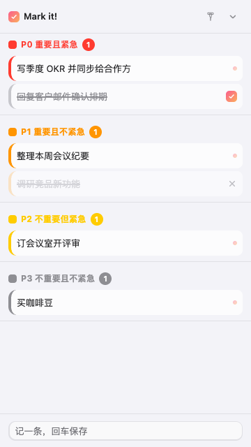
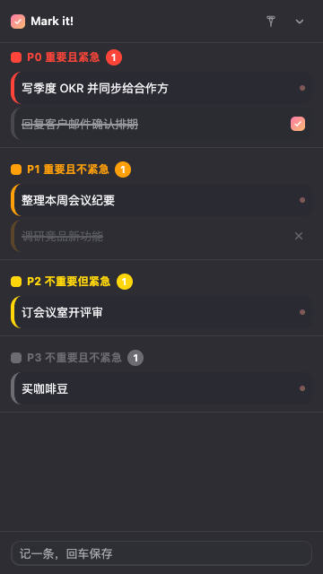

# Mark it! — plan for it

> A four-quadrant sticky-note board that lives in the corner of your desktop: jot things down, see your priorities at a glance.

No accounts, no login, no cloud sync — every note stays on your machine.



Dark mode is equally at home:



## What it is

A 360×640 mini board pinned to a corner of your screen, split into four zones following the Eisenhower Matrix:

| Zone | Meaning |
| --- | --- |
| **P0** | Important & urgent — do it now |
| **P1** | Important, not urgent — schedule it |
| **P2** | Not important, but urgent — handle quickly |
| **P3** | Not important, not urgent — capture for later |

Collapse it into a tiny capsule (4-color dots + open-count badge) with one click, and expand it back just as fast.

## Download

Grab the latest build from [Releases](https://github.com/tangchauyi/markit/releases/latest):

| Platform | File | Install |
| --- | --- | --- |
| Windows x64 | `Mark it! Setup x.x.x.exe` | One-click installer, no admin rights needed |
| macOS Apple Silicon | `Mark-it-x.x.x-arm64.dmg` | Drag into Applications |

> This is a hobby project without a paid code-signing certificate. Your OS may show a security prompt on first launch — choose "More info → Run anyway" on Windows, or right-click → Open on macOS.

## Quick start: your first note in 30 seconds

1. Launch the app — the board appears near the bottom-right corner (and remembers its position)
2. Click the input bar at the bottom, type, hit **Enter** — the note lands in P3
3. Want it in another zone? **Double-click any empty spot in that zone** and type — it inherits the zone's priority
4. Copied something anywhere? **Hover over a zone and press ⌘V / Ctrl+V** to drop it in as a note

## Interaction cheat sheet

| Action | How |
| --- | --- |
| Quick note (defaults to P3) | Type in bottom bar + Enter |
| Note into a specific zone | Double-click empty area of that zone |
| Paste as a note | Hover a zone + ⌘V / Ctrl+V |
| Edit a note | **Double-click the note** (or hover → ✎); click elsewhere to save, Esc to cancel |
| Reorder | **Long-press** a note (~0.5s), then drag up/down and release |
| Move across zones | Long-press, **drag into another zone**, release above/below the row under your cursor |
| Mark done | Hover → ✓ |
| Drop it (not doing it) | Hover → ⊘ (sinks to the bottom in grey) |
| Undo a status | Hover → ↺ |
| Undo a delete | Click "Undo" in the toast at the bottom |
| Review your days | Calendar icon in the top bar — click any day in the month view |
| Understand the P badges | Hover a badge for its full name; double-click to toggle compact/expanded titles |
| Move the board | Drag the top bar |
| Keep on top | Pin icon in the top bar |
| Collapse | Collapse button → mini capsule |

The UI follows your system's light/dark appearance. Notes are persisted to disk in real time — everything survives a reboot.

## Data & privacy

- Notes live in a local file — **no network calls, no telemetry, no analytics**
- Storage location:
  - macOS: `~/Library/Application Support/Mark it!/markit-notes.json`
  - Windows: `%APPDATA%\Mark it!\markit-notes.json`
- Backup = copy that file; migrate to a new machine = copy it over

## Run from source

```bash
git clone https://github.com/tangchauyi/markit.git
cd markit
npm install
npm start          # dev run
npm run dist       # build macOS DMG
npm run dist:win   # build Windows NSIS installer
```

Requires Node.js ≥ 18. Behavior self-tests live in `.selftest/` (300+ assertions, `node .selftest/v19.js`).

## Tech

Electron + vanilla JS (zero frameworks, zero build step — the renderer is readable as-is).
The main process handles the frameless window and file persistence; see `design.md` for the design spec.

## License

A personal hobby project. Source code for learning and sharing.
